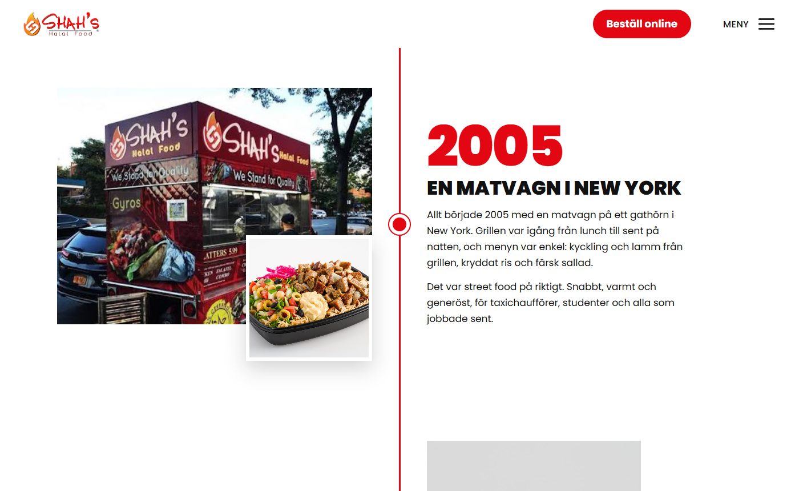
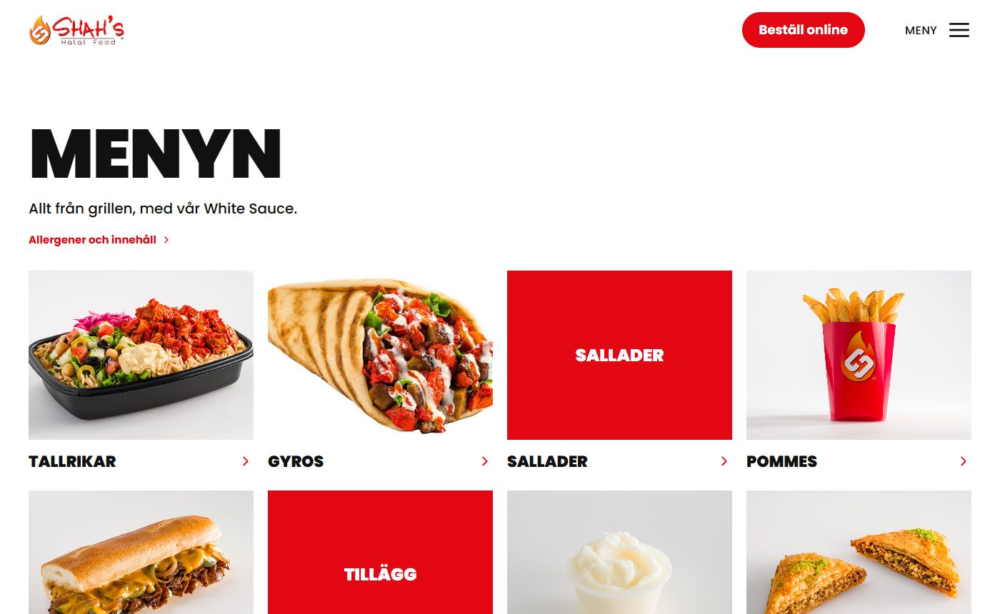
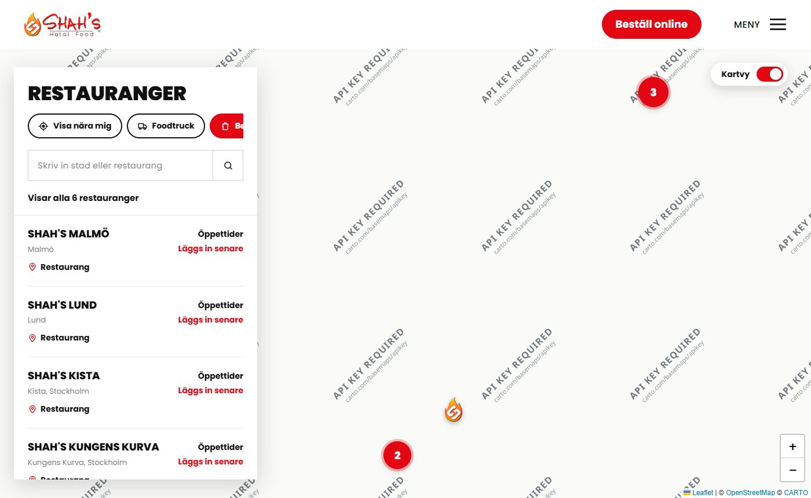
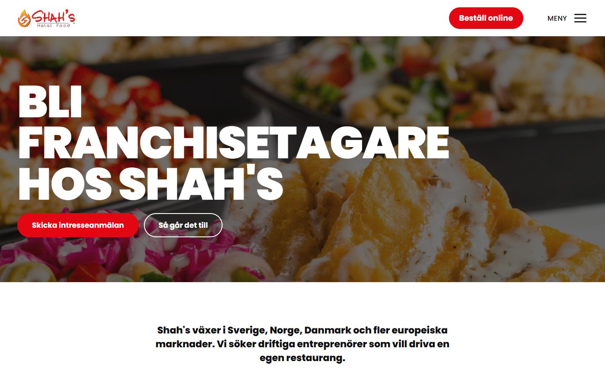
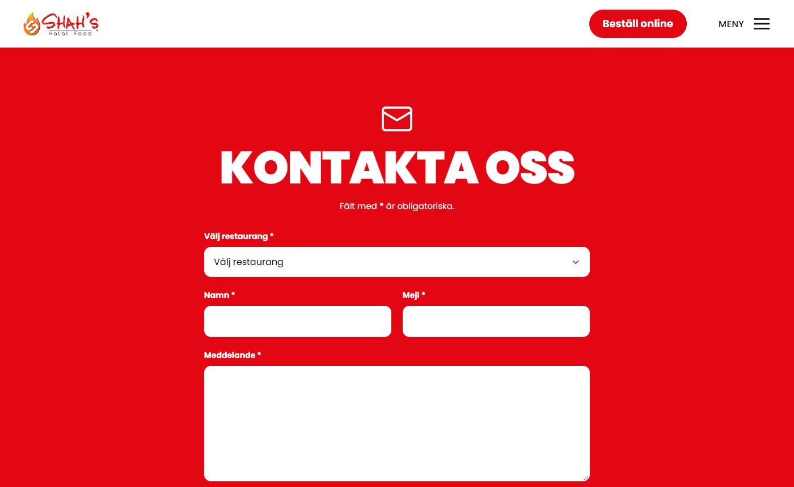

# Shah's Halal Food – webbplats

Ny webbplats för Shah's Halal Food, originalet från New Yorks gator sedan 2005, med restauranger i Sverige, Norge och Danmark.

**Demo:** `https://<ditt-användarnamn>.github.io/<repo-namn>/` *(fyll i när GitHub Pages är aktiverat, se nedan)*


## Sidor

| Om oss – historien som tidslinje | Menyn |
| --- | --- |
|  |  |
| **Hitta oss – karta med alla restauranger** | **Bli franchisetagare** |
|  |  |
| **Kontakta oss** | |
|  | |

- **Startsida** med film som loopar, och sektioner om Shah's, tallrikarna och konceptet
- **Om oss** med historien som tidslinje, från matvagnen i New York 2005 till idag
- **Meny** med kategorier och produkter, och **Produktinformation** med allergentabell och filter
- **Hitta oss** med restauranglista och karta, plus en Kartvy med sök, "Visa nära mig" och foodtruck-filter
- **Bli franchisetagare** och **Jobba hos oss** med ansökningsformulär (CV-uppladdning på jobbsidan)
- **Kontakta oss** och **FAQ**

## Teknik

- **Frontend:** React 18 och Vite, med en komponent och en CSS-fil per sida och sektion
- **Karta:** Leaflet med markercluster och OpenStreetMap-data
- **Backend:** Node.js och Express som tar emot formulären, kontrollerar fälten och sparar inskick och CV
- **Responsiv** för mobil och dator, med text som tonar in vid scroll

## Kör lokalt

Kräver [Node.js](https://nodejs.org) 20 eller senare.

```bash
npm install
npm run dev
```

Öppna http://localhost:5173. Formulären skickas till API:t på port 3001, som startar samtidigt.

Produktionsbygge med server:

```bash
npm run build
npm start
```

## Publicera demon på GitHub Pages

1. Ladda upp projektet till ett repo på GitHub, med grenen `main`.
2. Gå till **Settings → Pages** i repot och välj **Source: GitHub Actions**.
3. Flödet i `.github/workflows/deploy.yml` bygger och publicerar sidan vid varje push till `main`.
   Följ förloppet under fliken **Actions**.

Demon på GitHub Pages har ingen backend. Formulären visar tackrutan men skickar ingenting.

## Struktur

```
src/
  pages/        en fil per sida
  components/   layout, sektioner, karta och formulär
  data/         allt innehåll: restauranger, meny, allergener, FAQ, jobb och historia
  hooks/, lib/  routing, scroll-animationer, formulär, API och karta
public/         bilder och typsnitt
server/         Express-API för formulären
```

Innehåll ändras i `src/data/`. Färger och knappar finns i `src/styles/base.css`.

## Kvar innan lansering

- Exakta koordinater och öppettider för restaurangerna (`src/data/restaurants.js`)
- Allergendata till tabellen (`src/data/allergens.js`)
- Länkar till sociala medier i footern
- Koppling till ett riktigt beställningssystem för "Beställ online"
- Mejlnotiser för inskickade formulär, och rutiner för personuppgifter (GDPR)
- Leverantör av kartbilder för kommersiellt bruk, se `.env.example`
